## UIII Act4  Importación y descripción de datos con Pandas ML
## Samuel Martinez NC 0096
## El estudiante aprenderá a realizar un análisis exploratorio de datos (EDA, Exploratory Data Analysis) utilizando las bibliotecas Pandas y Matplotlib.
## equipamiento deportivo

## TABLA ORIGINAL DE EQUIPAMENTO
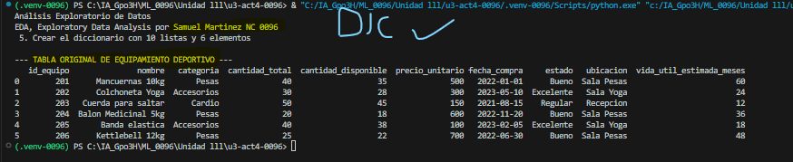
## 7. Convertir el DataFrame en archivo CSV
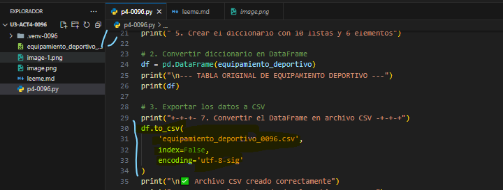
## Datos en csv --> base de datos
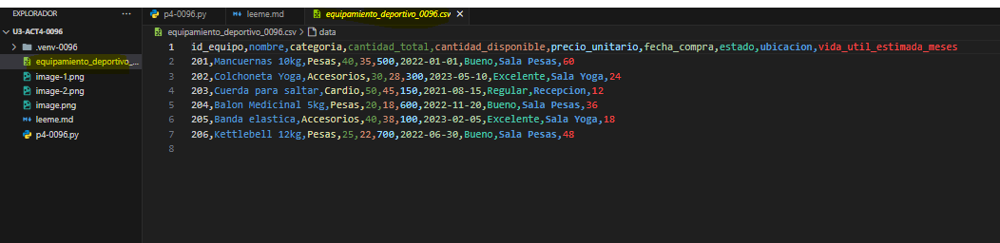
## 8. Leer los datos desde el archivo CSV
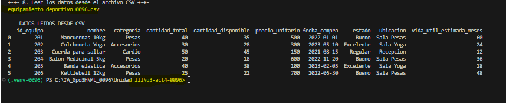
## 9. Análisis Exploratorio de Datos (EDA)
## primeros y ultimos registros
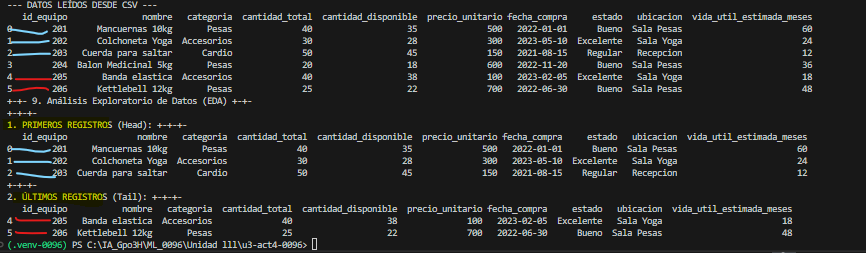
## 6. Dimensiones y estructura
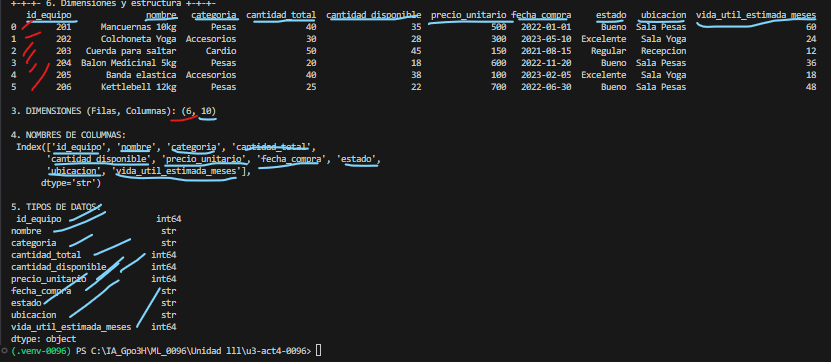
## 7. Estadisticas y limpieza
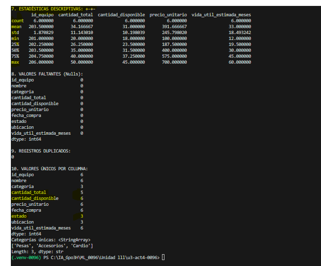
## 8 y 9 Ordenamiento, filtrado y agrupacion
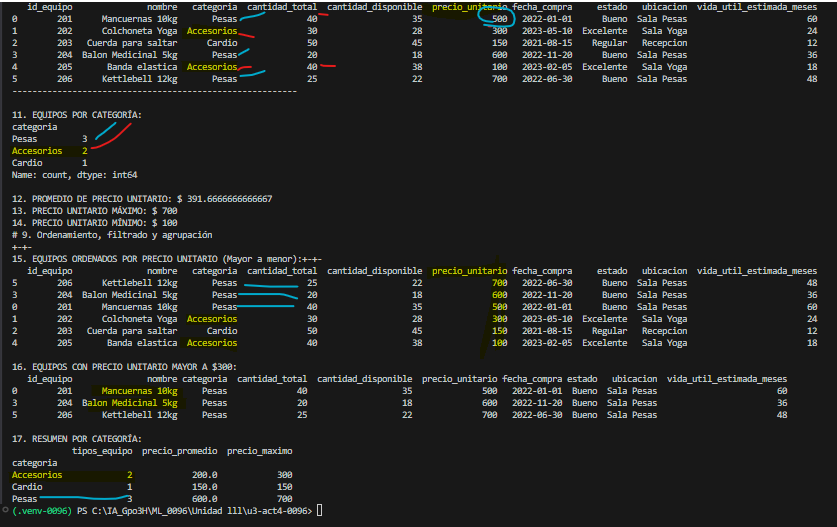
## 18. Gráfica de barras: Equipamento por departamento
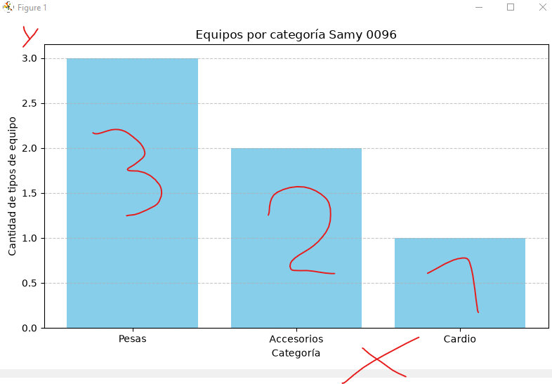
## 19. Gráfica de barras: precio por equipamento
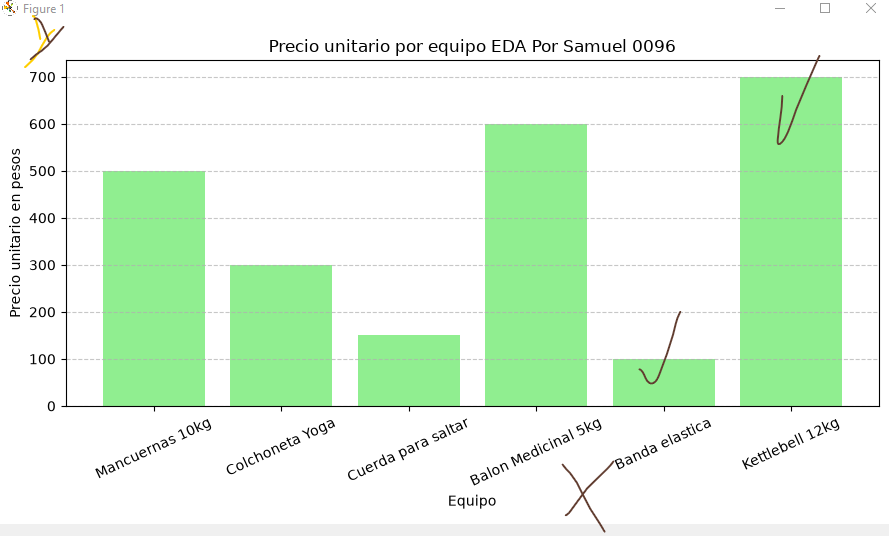
## 20. Histograma: Distribución de equipamento
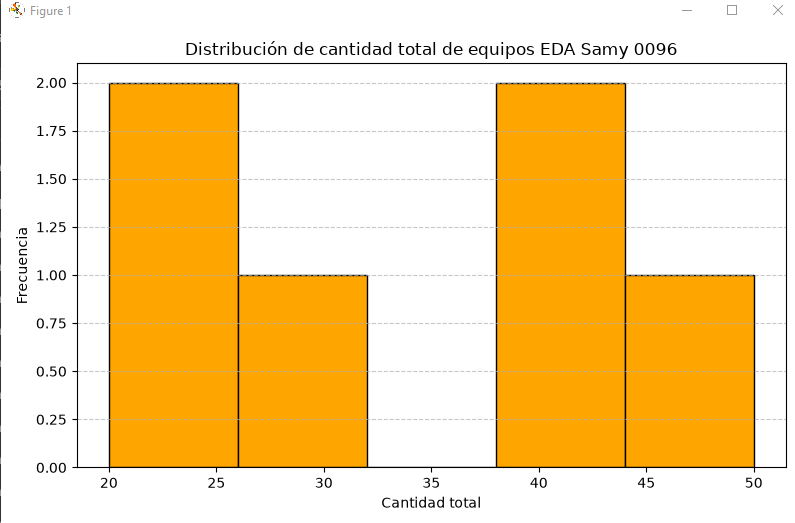
## 21. Gráfica de dispersión: Vida util vs precio
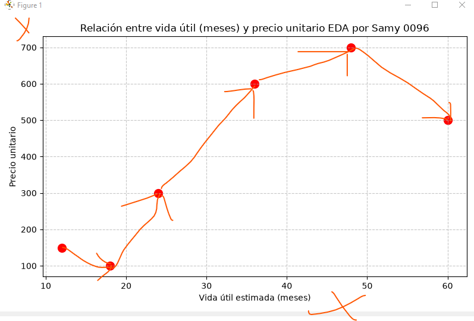
## 22. Diagrama de caja: Distribución de precios unitarios
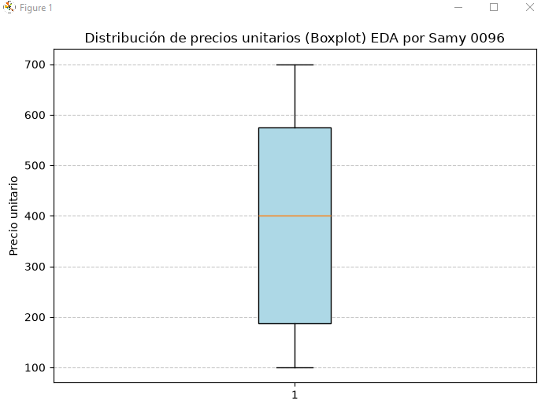
## 23. Matriz de correlación
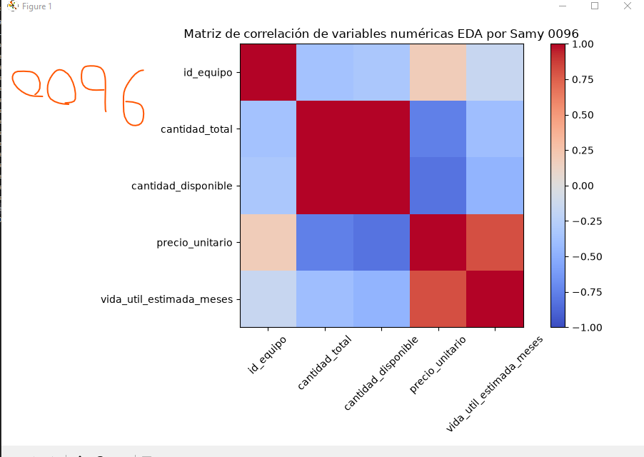
